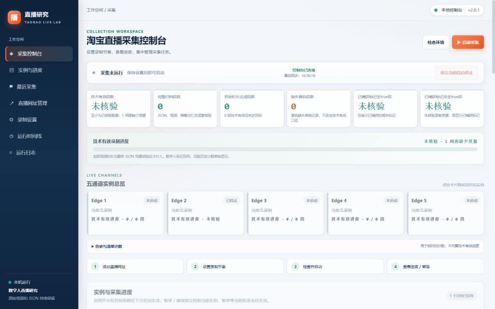
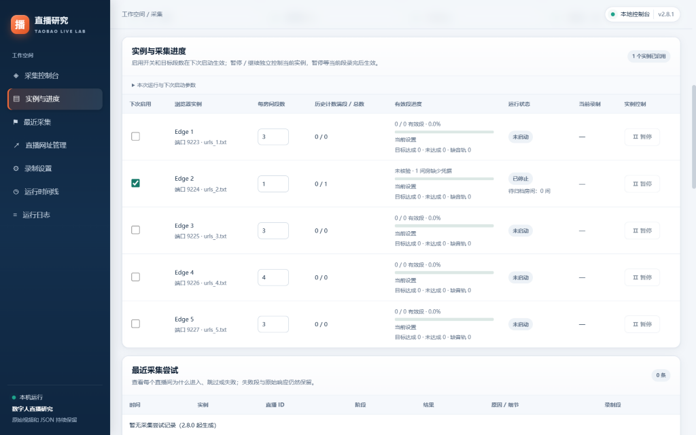
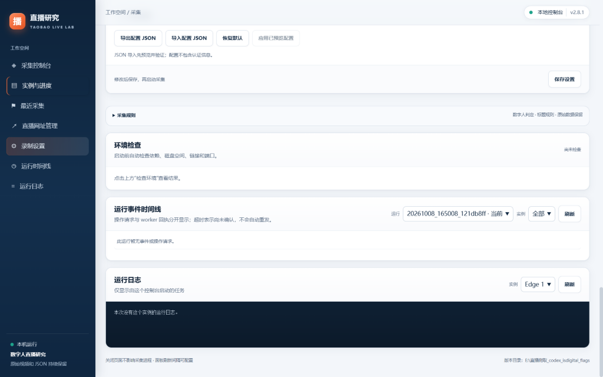

# Taobao Live Scraper / 淘宝直播爬虫

[](https://github.com/lengzhanbao/taobao_scraper/releases)
[](https://www.python.org/downloads/)
[](LICENSE)
[](https://github.com/lengzhanbao/taobao_scraper/stargazers)

[English](#english) | [中文](#chinese)

---

<a name="chinese"></a>

## 📖 简介

当前控制台版本：**2.8.1**。在保留原有采集、归档与恢复能力的基础上，提供录制质量三分解（技术有效 / 目标时长达成 / 音视频事实）、商品事件与商品区间、响应归属等级、时间证据和采集尝试台账；2.8.1 进一步升级了本地控制台视觉与交互动效，并修复了 FIFO 调度、2.8 启动对账兼容、跨房商品归属、Windows 原子写盘与大样本面板轮询性能问题。

**Taobao Live Scraper** 是一个专业的淘宝直播数据采集工具，专注于数字人直播间的监控、录制和分析。

### 核心功能

**本地采集控制台（2.8.1）**：在本机网页管理最多 5 个 Edge 采集实例、直播网址清单、录制参数、进度、环境检查和运行日志。采用毛玻璃粘性顶栏、深色终端日志框、运行态呼吸脉冲与通道流动状态条等交互动效；支持参数 JSON 配置与运行快照；修改保存后下次启动生效。控制台仅监听本机回环地址；只有点击“启动采集”后才启动采集任务。详见 [控制台使用说明](docs/control-panel.md)。

✅ **多实例并行录制** - 5个独立浏览器实例，同时监控不同直播间  
✅ **智能数字人检测** - 自动识别数字人主播直播间  
✅ **完整数据采集** - 视频录制 + 弹幕抓取 + 商品信息 + 直播数据  
✅ **自动化归档** - 录制完成后自动解析并整理到结构化目录  
✅ **防封禁设计** - 随机延迟、冷却机制、人性化操作模拟  

### 适用场景

- 📊 电商直播数据研究
- 🤖 数字人直播行为分析
- 📈 直播带货效果监测
- 💼 竞品直播策略分析
- 🎓 学术研究数据采集

### 🖥️ 本地控制台界面预览（v2.8.1）



<details>
<summary>点击展开更多界面截图（实例进度表 / 深色终端日志框）</summary>

**实例与采集进度 · 最近采集尝试**


**环境检查 · 运行时间线 · 深色日志终端**


</details>

### ✨ 2.8.1 稳定性与体验更新

- **调度与对账修复**：修复已录房间 `hot` 队列的 FIFO 排序被随机抽取抵消的问题；修复全部剩余房间均达失败上限时无限空转的问题；修复启动对账（`recovery.py`）与 2.8 质量凭据字段不兼容导致的误报，并消除对账时对同一视频的 3 次重复哈希计算。
- **数据归属与解析加固**：修复无 `attribution_status` 的历史响应可能跨房间串号的问题；`itemExtData` 增加字符串 JSON 容错；归档目录命名与商品事件摘要按当前房间归属与过滤结果保持一致；`write_csv` 改为原子写入。
- **Windows 长跑与面板性能**：`safe_io` 增加 Windows 瞬时文件占用重试与临时文件清理；`RetryState` 改为单一滚动 `.bak` 备份；`EvidenceCache` 升级为线程安全 LRU 并缓存归档摘要；减少 `/api/state` 单次轮询重复读盘，`/api/urls` POST 上限放宽至 128 KB。
- **控制台视觉与动效升级**：毛玻璃粘性顶栏、深色仪器风侧栏与日志终端、运行态呼吸脉冲指示灯、通道流动状态条、进度条光泽过渡、微抬升卡片动效与采集结果彩色徽章（完整支持 `prefers-reduced-motion`），同时修复前端版本号语义判断。

---

### 研究数据升级 2.8.0：质量、商品事件与时间证据

2.8.0 的改动目标是提高已有采集结果对科研分析的支持能力，而不是增加采集数量或重做控制台。新增输出与字段说明见 [研究数据升级说明](docs/RESEARCH_DATA_UPGRADE.md)，逐项修改与测试结果见 [优化报告](OPTIMIZATION_REPORT.md)。

| 新增输出 | 位置 | 用途 |
|---|---|---|
| `recording_quality.json` | 每次 attempt 目录及 `sessions/<房间>/` | 技术有效性、目标时长达成、音轨/编码/分辨率/帧率；缺失事实为 `unknown`。 |
| `timing_evidence.json` | 同上 | 墙钟、媒体 PTS、接口接收时间、FFmpeg 重连与页面刷新事件，以及近似/未解决的对齐状态。 |
| `product_events.jsonl` / `product_events_strict.jsonl` / `product_events_candidate.jsonl` | 同上 | 商品观测合并视图、严格 `matched` 集、候选 `context_only` 集；两套统计互不覆盖。 |
| `product_intervals.jsonl` | 同上 | 仅在相邻“当前商品候选”观测之间推断的候选区间；`is_continuity_observed=false`，不把单次观测伪造为持续时间。 |
| `recordings/<recording_id>/` | `sessions/<房间>/` | 每个录制段独立的质量、时间、商品文件和 `manifest.json`（含 SHA256）；归档核验按 `recording_id` 闭环。 |
| `collection_attempts_instance_<N>.jsonl` | 运行控制目录或独立模式的 staging | 记录未开播、非数字人、网络、验证码、接流、录制与核验失败原因，解释样本如何形成。 |

**兼容边界：** 旧版最终 JSON 仍可解析；`technical_validation` 保持 schema 1；旧 `unscoped` 归属映射为 `context_only`；原始视频、JSONL、JSON、CSV 与日志不会被删除或改写。严格派生统计只接受 `matched` 响应，其余原始响应保留在 journal。

控制台新增“最近采集尝试”表：可直接看到每个直播间是已录制、按规则跳过、网络失败、验证码超时还是录制/核验失败，并显示失败原因、重试次数、录制段和目标达成状态。网址清单表新增“质量”列，按房间显示目标达成与缺失音轨计数；这些数字仍与技术有效段、完整归档段分开。

### 控制台 2.8.1：快速启动与计数说明

**前置条件：** Python 3.9 或更高版本；安装 `requirements.txt` 中依赖（采集器需要 `DrissionPage`）；已安装 Edge、FFmpeg 和 FFprobe。控制台本身使用 Python 标准库提供本机网页服务，不依赖网页框架。首次打开后，在“录制设置”中配置数据目录及 Python、Edge、FFmpeg、FFprobe 路径，保存设置并通过“检查环境”后，再按需点击“启动采集”。

Windows 可双击 `scripts/open_control_panel.vbs`（默认调用 `pythonw.exe`），或在项目目录运行：

```powershell
python -m pip install -r requirements.txt
python -B scripts/control_panel.py --open
```

页面地址为 `http://127.0.0.1:8765`。Linux/macOS 可使用同一 Python 命令启动控制台；采集环境路径需在页面中配置。没有 Cookie 时，可在启动后的 Edge 窗口登录。

| 页面指标 | 含义 |
|---|---|
| 历史计数 | URL 清单或历史进度中的累计数，用于续录位置；不代表旧视频已重新验证。 |
| 技术有效段 | 有 FFprobe 实测时长及匹配文件凭据的录制段；全无凭据时显示“未核验”，部分已核验时只汇总有证据部分并标注“至少”。 |
| 完整归档段 | 归档清单中成套核验通过的段，依据 JSON、视频、弹幕 CSV、汇总行和对应文件凭据。旧归档缺少凭据时不补造验证结果。 |
| 目标时长达成段 | 有进度凭据、实际时长达到目标 90% 的段；与技术有效段分开显示，避免把 7 分钟视频当成 20 分钟任务完成。 |
| 缺失音轨段 | FFprobe 明确报告无音频流的段；音轨事实未知时不归入缺失。 |
| 已捕获数字人标记 | 仅统计可关联当前直播 ID 的已捕获平台标记：全 true、非全 true、缺失分别计数。它不表示整段连续观测，也不额外定义样本分类。 |

旧数据没有新版验证凭据时会保留历史计数并显示待核验；控制台不会把未知段当成技术有效段。控制台的目标时长达成与音轨计数目前来自进度凭据中可核验的段；只有归档清单、没有进度凭据的段会显示为未知，而不是推断为达成。2.8.0 本轮未执行真实淘宝直播长时端到端运行；所有测试均为离线/合成验证。网址文件锁是协作式 sidecar 锁；不遵守该锁的外部编辑器仍可能在极窄的写入窗口造成并发覆盖。

---

## 🚀 快速开始

### 系统要求

- **操作系统**: Windows 10/11 (推荐), Linux, macOS
- **Python**: 3.9 或更高版本
- **浏览器**: Microsoft Edge (Windows) 或 Chrome/Chromium
- **FFmpeg**: 用于视频录制
- **硬盘空间**: 建议至少 50GB (用于视频存储)

### 安装步骤

#### 1. 克隆项目

```bash
git clone https://github.com/lengzhanbao/taobao_scraper.git
cd taobao_scraper
```

#### 2. 安装Python依赖

```bash
# 推荐使用虚拟环境
python -m venv .venv
.venv\Scripts\activate  # Windows
# source .venv/bin/activate  # Linux/Mac

# 安装依赖
pip install -r requirements.txt
```

#### 3. 准备FFmpeg

**Windows:**
- 下载 FFmpeg: https://ffmpeg.org/download.html
- 解压到 `DouyinLiveRecorder_v4.0.7/ffmpeg/`
- 确保 `ffmpeg.exe` 在该目录下

**Linux/Mac:**
```bash
# Ubuntu/Debian
sudo apt install ffmpeg

# macOS
brew install ffmpeg

# 设置环境变量
export LIVE_FFMPEG=$(which ffmpeg)
```

#### 4. 创建数据目录

```bash
# Windows PowerShell
New-Item -ItemType Directory -Force -Path "直播研究数据\_config"
New-Item -ItemType Directory -Force -Path "直播研究数据\_staging"
New-Item -ItemType Directory -Force -Path "直播研究数据\sessions"

# Linux/Mac
mkdir -p 直播研究数据/{_config,_staging,sessions}
```

#### 5. 配置URL列表

在 `直播研究数据/_config/` 目录下创建URL文件：

**urls_1.txt** (录制3段):
```
https://tbzb.taobao.com/live?liveId=123456789,店铺名称,已录制0/3
https://tbzb.taobao.com/live?liveId=987654321,另一个店铺,已录制0/3
```

**urls_4.txt** (录制4段):
```
https://tbzb.taobao.com/live?liveId=111222333,重点店铺,已录制0/4
```

> 💡 提示: `urls_1.txt`, `urls_2.txt`, `urls_3.txt`, `urls_5.txt` 每个直播间录3段  
> `urls_4.txt` 每个直播间录4段

#### 6. 准备登录Cookie

**方法1: 手动登录** (首次推荐)

运行单个爬虫实例，完成淘宝登录：

```bash
python scripts/crawler_instance_1.py
```

登录成功后，Cookie会自动保存到 `直播研究数据/_config/taobao_cookies.json`

**方法2: 导入现有Cookie**

如果已有Cookie，直接复制到 `直播研究数据/_config/taobao_cookies.json`

---

## 📚 使用说明

### 启动爬虫

**Windows - 隐藏窗口模式** (推荐):

```powershell
# 启动所有5个爬虫实例
powershell -ExecutionPolicy Bypass -File scripts\start_all_crawlers.ps1

# 查看运行状态
Get-Process python | Where-Object {$_.CommandLine -match "crawler_instance"}

# 停止所有爬虫
powershell -ExecutionPolicy Bypass -File scripts\stop_all_crawlers.ps1
```

**手动启动单个实例** (调试用):

```bash
# 启动实例1 (端口9223, urls_1.txt)
python scripts/crawler_instance_1.py

# 启动实例2 (端口9224, urls_2.txt)
python scripts/crawler_instance_2.py

# ...以此类推
```

### 数据处理

#### 解析录制数据

```bash
# 解析所有暂存数据并归档到sessions
python scripts/parse_data.py

# 解析指定房间
python scripts/parse_data.py "直播研究数据\_staging\browser_9223\room_123456789"
```

#### 更新URL状态

```bash
# 预览更新 (不写入)
python scripts/update_urls.py

# 确认无误后应用更新
python scripts/update_urls.py --apply
```

#### 收集数字人直播间

```bash
# 自动发现并收集数字人直播间URL
python scripts/collect_digital.py
```

---

## 📁 项目结构

```
taobao-live-scraper/
├── src/                          # 源代码
│   ├── crawler/                  # 爬虫核心
│   │   └── taobao_crawler.py     # 主爬虫逻辑
│   ├── parser/                   # 数据解析
│   │   └── parse_data.py         # 数据解析器
│   ├── detector/                 # 数字人检测
│   │   ├── collect_digital.py    # URL收集器
│   │   └── detect_digital.py     # 检测脚本
│   └── utils/                    # 工具模块
│       ├── config.py             # 配置管理
│       └── update_urls.py        # URL状态更新
├── scripts/                      # 可执行脚本
│   ├── crawler_instance_1.py     # 爬虫实例1
│   ├── crawler_instance_2.py     # 爬虫实例2
│   ├── crawler_instance_3.py     # 爬虫实例3
│   ├── crawler_instance_4.py     # 爬虫实例4
│   ├── crawler_instance_5.py     # 爬虫实例5
│   ├── start_all_crawlers.ps1    # 启动所有爬虫
│   ├── stop_all_crawlers.ps1     # 停止所有爬虫
│   ├── parse_data.py             # 数据解析入口
│   ├── update_urls.py            # URL更新入口
│   └── collect_digital.py        # 收集数字人入口
├── config/                       # 配置模板
│   ├── urls_template.txt         # URL配置模板
│   ├── cookies_template.json     # Cookie模板
│   └── README.md                 # 配置说明
├── docs/                         # 文档
├── examples/                     # 使用示例
├── 直播研究数据/                 # 数据目录 (不在git中)
│   ├── _config/                  # 配置文件
│   │   ├── urls_1.txt ~ urls_5.txt
│   │   └── taobao_cookies.json
│   ├── _staging/                 # 录制暂存
│   └── sessions/                 # 归档数据
│       └── <店铺名>_<liveId>/
│           ├── video/            # 视频文件
│           ├── crawler/          # CSV数据
│           └── raw/              # 原始JSON
├── .github/                      # GitHub配置
├── requirements.txt              # Python依赖
├── .gitignore                    # Git忽略规则
└── README.md                     # 本文件
```

---

## ⚙️ 环境变量配置

可以通过环境变量自定义路径：

| 变量名 | 默认值 | 说明 |
|--------|--------|------|
| `LIVE_STUDY_ROOT` | `./直播研究数据` | 数据根目录 |
| `LIVE_FFMPEG` | `./DouyinLiveRecorder_v4.0.7/ffmpeg/ffmpeg.exe` | FFmpeg路径 |
| `LIVE_PYTHON` | `python` | Python可执行文件 |
| `LIVE_EDGE_PATH` | Windows默认Edge路径 | Edge浏览器路径 |

**Windows示例:**
```powershell
$env:LIVE_STUDY_ROOT = "D:\TaobaoData"
$env:LIVE_FFMPEG = "D:\Tools\ffmpeg\bin\ffmpeg.exe"
```

**Linux/Mac示例:**
```bash
export LIVE_STUDY_ROOT="/home/user/taobao_data"
export LIVE_FFMPEG="/usr/bin/ffmpeg"
```

---

## 🔧 常见问题

### 1. Cookie过期或登录失效

**解决方法:**
- 删除 `直播研究数据/_config/taobao_cookies.json`
- 重新运行单个爬虫实例进行登录
- 或手动从浏览器导出新Cookie

### 2. 提示找不到FFmpeg

**解决方法:**
```bash
# 检查FFmpeg是否存在
ffmpeg -version

# 如果已安装但路径不同，设置环境变量
$env:LIVE_FFMPEG = "实际的ffmpeg.exe路径"
```

### 3. 爬虫启动后无反应

**可能原因:**
- 端口被占用 (9223-9227)
- Edge浏览器未安装
- 网络连接问题

**检查方法:**
```powershell
# 查看爬虫日志
Get-Content _logs\hidden_launch\crawler_1_*.log -Tail 50

# 检查端口占用
netstat -ano | findstr "9223"
```

### 4. 视频录制失败

**检查清单:**
- ✅ FFmpeg正确安装
- ✅ 直播间处于开播状态
- ✅ 网络连接稳定
- ✅ 硬盘空间充足

### 5. 如何避免账号被封

**建议:**
- 使用小号进行爬取
- 不要频繁更换IP
- 遵守合理的冷却时间 (默认2小时)
- 不要同时监控过多直播间

---

## 📊 输出数据说明

### sessions目录结构

```
sessions/<店铺名>_<liveId>/
├── video/
│   ├── <店铺名>_video_第1段.flv
│   ├── <店铺名>_video_第2段.flv
│   └── <店铺名>_video_第3段.flv
├── crawler/
│   ├── lives_summary_<店铺名>_<liveId>.csv      # 直播汇总数据
│   ├── comments_第1段_<店铺名>_<liveId>.csv     # 第1段弹幕
│   ├── comments_第2段_<店铺名>_<liveId>.csv     # 第2段弹幕
│   └── comments_第3段_<店铺名>_<liveId>.csv     # 第3段弹幕
└── raw/
    ├── data_20260902_143022_final.json          # 第1段原始数据
    ├── data_20260902_151534_final.json          # 第2段原始数据
    └── data_20260902_160047_final.json          # 第3段原始数据
```

### CSV数据字段

**lives_summary CSV 包含:**
- 基本信息: 标题、主播名、直播间链接
- 时间数据: 录制时间、直播时长
- 互动数据: 弹幕数、观看人数、点赞数、粉丝增长
- 商品信息: 当前商品名称、价格、直播专属价
- 标识字段: 是否数字人、品类、店铺类型

#### 数字人标记口径

- `平台原始isDigitalAnchorLive` 保留每段接口实际返回值：`true`、`false`、混合值或缺失；`false` 不再和字段缺失混成空白。
- `段落是否全true`、`段落是否含false` 标记每个录制段；`房间是否全段true`、`房间是否含false` 和 true/false/缺失段数标记该 `room_<liveId>` 的汇总。
- 平台标记只有每段都明确为 `true` 才算“平台全true”。存在 `false` 的段标记为排除候选；保留汇总行和原始 JSON 供核查，不删除文件。
- `false` 表示平台没有把该段标为数字人，不单凭这个字段断言视频里一定是真人；视频核验结果需要单独记录。
- 标题包含“虚拟主播”或“智能主播”时，按研究口径单独覆盖为数字人；平台原始值仍如实记录，不会把 `false` 改写成 `true`。
- 此处 room 按采集目录中的 `liveId` 汇总；不同 `liveId` 的相同店铺/标题不会由本解析器自动合并。

**comments CSV 包含:**
- 用户昵称
- 弹幕内容
- 发送时间

---

## 🤝 贡献指南

欢迎提交Issue和Pull Request！

### 开发环境设置

```bash
# Fork项目并克隆
git clone https://github.com/YOUR_USERNAME/taobao_scraper.git
cd taobao_scraper

# 创建开发分支
git checkout -b feature/your-feature-name

# 安装开发依赖
pip install -r requirements.txt

# 提交更改
git add .
git commit -m "Add: your feature description"
git push origin feature/your-feature-name
```

---

## 📄 开源协议

本项目采用 MIT 协议 - 详见 [LICENSE](LICENSE) 文件

---

## ⚠️ 免责声明

本工具仅用于学习和研究目的。使用本工具时请遵守：

- 淘宝平台的服务条款和robots协议
- 相关法律法规
- 数据隐私保护要求

请勿将本工具用于：
- 商业目的
- 大规模数据采集
- 侵犯他人隐私的行为

使用本工具产生的一切后果由使用者自行承担。

---

## 📮 联系方式

- GitHub Issues: [提交问题](https://github.com/lengzhanbao/taobao_scraper/issues)
- Email: 3496458527@qq.com

---

<a name="english"></a>

## 📖 Introduction (English)

**Taobao Live Scraper (v2.8.1)** is a professional data collection tool for Taobao live streaming, focusing on monitoring, recording, and analyzing digital human live rooms.

### Key Features

**Local collection panel (2.8.1):** Manage up to five Edge crawler instances, URL lists, recording settings, environment checks, recent collection attempts, timelines, and dark-terminal logs through a loopback-only web interface with smooth status animations and live channel indicators. Crawlers start only after an explicit click. See the [control panel guide](docs/control-panel.md) and [research data upgrade guide](docs/RESEARCH_DATA_UPGRADE.md).


✅ **Multi-Instance Parallel Recording** - 5 independent browser instances with FIFO cooldown scheduling for resumed rooms  
✅ **Smart Digital Human Detection** - Tri-state `isDigitalAnchorLive` tracking (`true` / `false` / `missing`) + title keyword rules  
✅ **Research-Grade Evidence (2.8.x)** - Three-way recording quality split, strict/candidate product events & intervals, timing evidence, and collection attempt ledgers  
✅ **Automated Verified Archiving** - Per-recording SHA-256 verification and atomic Windows-safe writes  
✅ **Anti-Ban & Stability Design** - Random delays, failure cooldown budgets, retry-exhausted clean exit, and rolling backups  

### Use Cases

- 📊 E-commerce live streaming data research
- 🤖 Digital human live behavior analysis
- 📈 Live commerce effectiveness monitoring
- 💼 Competitive live strategy analysis
- 🎓 Academic research data collection

---

### Control Panel 2.8.1: Quick Start and Metrics

**Prerequisites:** Python 3.9+, dependencies from `requirements.txt` (the crawler requires `DrissionPage`), Microsoft Edge, FFmpeg, and FFprobe. The panel web server uses Python's standard library and needs no web framework. On first launch, configure the data directory and Python, Edge, FFmpeg, and FFprobe paths in Recording Settings; save and pass Environment Check before explicitly starting collection.

On Windows, double-click `scripts/open_control_panel.vbs` (it uses `pythonw.exe` by default), or run from the repository directory:

```powershell
python -m pip install -r requirements.txt
python -B scripts/control_panel.py --open
```

Open `http://127.0.0.1:8765`. Linux/macOS can use the same Python command; configure the crawler executable paths in the panel. If no Taobao cookie exists, log in through the Edge window after starting collection.

| Panel metric | Meaning |
|---|---|
| Historical count | Count from URL lists or legacy progress; used as the resume position, not proof that old videos were revalidated. |
| Technically valid segments | Segments with measured FFprobe duration and matching file evidence. If no evidence exists, the panel shows “unverified”; partial totals include only evidenced segments and are marked “at least.” |
| Complete archive segments | Segments whose archive manifest verifies the JSON, video, comment CSV, summary row, per-recording analysis files, and SHA-256 evidence. |
| Target duration met | Verified segments reaching at least 90% of configured target duration, tracked separately from technical validity. |
| Missing audio segments | Verified segments where FFprobe explicitly confirms no audio stream; unknown media facts are kept separate. |
| Captured digital-human markers | Counts only captured platform markers linked to the current live ID: all true, not all true, and missing. This does not prove continuous observation or define an additional sample category. |

Legacy data without current verification evidence retains its historical count and is shown as unverified; unknown segments are not counted as technically valid. The current fixes have not been validated in a long-duration end-to-end run against a real Taobao live stream. URL updates use a cooperative sidecar file lock; an external editor that ignores the lock can still race in a narrow write window.

---

## 🚀 Quick Start (English)

### System Requirements

- **OS**: Windows 10/11 (recommended), Linux, macOS
- **Python**: 3.9 or higher
- **Browser**: Microsoft Edge (Windows) or Chrome/Chromium
- **FFmpeg**: For video recording
- **Disk Space**: At least 50GB recommended

### Installation

#### 1. Clone Repository

```bash
git clone https://github.com/lengzhanbao/taobao_scraper.git
cd taobao_scraper
```

#### 2. Install Python Dependencies

```bash
# Use virtual environment (recommended)
python -m venv .venv
.venv\Scripts\activate  # Windows
# source .venv/bin/activate  # Linux/Mac

# Install dependencies
pip install -r requirements.txt
```

#### 3. Setup FFmpeg

**Windows:**
- Download FFmpeg from https://ffmpeg.org/download.html
- Extract to `DouyinLiveRecorder_v4.0.7/ffmpeg/`
- Ensure `ffmpeg.exe` is in that directory

**Linux/Mac:**
```bash
# Ubuntu/Debian
sudo apt install ffmpeg

# macOS
brew install ffmpeg

# Set environment variable
export LIVE_FFMPEG=$(which ffmpeg)
```

#### 4. Create Data Directories

```bash
# Windows PowerShell
New-Item -ItemType Directory -Force -Path "直播研究数据\_config"
New-Item -ItemType Directory -Force -Path "直播研究数据\_staging"
New-Item -ItemType Directory -Force -Path "直播研究数据\sessions"

# Linux/Mac
mkdir -p 直播研究数据/{_config,_staging,sessions}
```

#### 5. Configure URL Lists

Create URL files in `直播研究数据/_config/`:

**urls_1.txt** (record 3 segments):
```
https://tbzb.taobao.com/live?liveId=123456789,Shop Name,已录制0/3
```

See Chinese section for detailed format.

#### 6. Setup Login Cookies

**Method 1: Manual Login** (First time recommended)

```bash
python scripts/crawler_instance_1.py
```

Login via QR code, cookies will be saved automatically.

**Method 2: Import Existing Cookies**

Copy your cookies to `直播研究数据/_config/taobao_cookies.json`

---

## 📚 Usage (English)

### Start Crawlers

**Windows - Hidden Mode** (Recommended):

```powershell
# Start all 5 crawler instances
powershell -ExecutionPolicy Bypass -File scripts\start_all_crawlers.ps1

# Check running status
Get-Process python | Where-Object {$_.CommandLine -match "crawler_instance"}

# Stop all crawlers
powershell -ExecutionPolicy Bypass -File scripts\stop_all_crawlers.ps1
```

### Data Processing

#### Parse Recorded Data

```bash
# Parse all staged data
python scripts/parse_data.py

# Parse specific room
python scripts/parse_data.py "直播研究数据\_staging\browser_9223\room_123456789"
```

#### Update URL Status

```bash
# Preview updates (dry-run)
python scripts/update_urls.py

# Apply updates
python scripts/update_urls.py --apply
```

#### Collect Digital Live Rooms

```bash
# Discover and collect digital human live room URLs
python scripts/collect_digital.py
```

---

## 📄 License

This project is licensed under the MIT License - see [LICENSE](LICENSE) file for details.

---

## ⚠️ Disclaimer

This tool is for educational and research purposes only. Users must comply with Taobao's terms of service and local laws. The author is not responsible for any misuse.

---

## 🔍 SEO Keywords / 搜索关键词

**中文：** 淘宝直播爬虫, 淘宝直播录制, 淘宝直播数据采集, 直播录制工具, 弹幕爬虫, 弹幕抓取, 数字人检测, 数字人直播, 虚拟主播检测, AI主播识别, 电商直播分析, 直播带货数据, 竞品直播监控, 直播间监控, 商品信息采集, 淘宝API采集, 直播数据研究, Python爬虫, DrissionPage实战, FFmpeg录制, mtop接口解析

**English:** Taobao Live Scraper, Taobao Live Recorder, live stream recorder, live data collection, barrage scraper, danmaku crawler, comment抓取 crawler, digital human detection, virtual anchor detection, AI streamer detection, e-commerce live analysis, live commerce monitoring, livestream monitoring, product info scraping, Taobao API scraping, mtop API parsing, DrissionPage example, FFmpeg recording, Python web scraping, live detail.get parser

**Related searches / 相关搜索：** tbzb.taobao.com 爬虫, live.detail.get 解析, isDigitalAnchorLive 检测, 淘宝直播弹幕接口, mtop.tblive 解析, 淘宝直播录屏, 直播间批量监控, 无人直播检测, 直播数据CSV导出


## 2026-09-29 GitHub 上传版检查记录

检查对象：本仓库 `main` 的提交 `6182db314417293b3eec5f1af6f8b8c1a4bdc2cb`。本记录仅针对该上传版本；只做静态检查和仓库自带测试，未启动淘宝登录、直播采集或数据解析入口，因此不代表真实采集已验证通过。

### 检查结果

- `python -m pytest tests/ -q`：7 项通过；爬虫和解析器语法检查通过。
- Windows 默认编码运行 `python verify_structure.py` 会因 GBK 无法输出 `✓` 而报 `UnicodeEncodeError`；`python -X utf8 verify_structure.py` 通过。
- 本次审查环境为 Python 3.11.7，未安装 `DrissionPage`。系统 PATH 能找到 FFmpeg，但全新副本缺少默认配置路径 `DouyinLiveRecorder_v4.0.7/ffmpeg/ffmpeg.exe`。部署时需安装 `requirements.txt` 依赖，并将 `LIVE_FFMPEG` 配为实际可执行文件路径。

### 当时发现的风险（已在 2.1 控制台版本修复）

以下记录针对上述历史提交。2.1 已移除自动删除和全局进程清理，补充缺 Cookie 的登录等待；细节见 [控制台说明](docs/control-panel.md)。

1. `scripts/collect_digital.py` 启动时强制结束系统中全部 `ffmpeg.exe` 和 `msedge.exe`，可能中断其他录制并关闭其他 Edge。不要在修复前运行该入口。[代码位置](https://github.com/lengzhanbao/taobao_scraper/blob/6182db314417293b3eec5f1af6f8b8c1a4bdc2cb/src/detector/collect_digital.py#L30-L42)
2. 主爬虫启动清理会递归删除部分没有 `_final.json` 的暂存段；录制时还会清理已有但未完成的段目录，可能造成数据丢失。修复清理逻辑并确认备份后，再对已有数据目录运行。[代码位置](https://github.com/lengzhanbao/taobao_scraper/blob/6182db314417293b3eec5f1af6f8b8c1a4bdc2cb/src/crawler/taobao_crawler.py#L42-L77)
3. 全新配置缺少 `taobao_cookies.json` 时，主爬虫会直接读取该文件并退出，未进入手动登录流程。README 声称爬虫登录后自动保存 Cookie，但主爬虫代码没有找到写入该 JSON 的逻辑，文档与实现不一致。[代码位置](https://github.com/lengzhanbao/taobao_scraper/blob/6182db314417293b3eec5f1af6f8b8c1a4bdc2cb/src/crawler/taobao_crawler.py#L620-L630)
